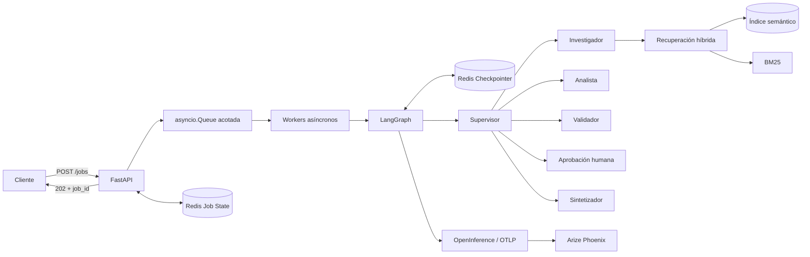
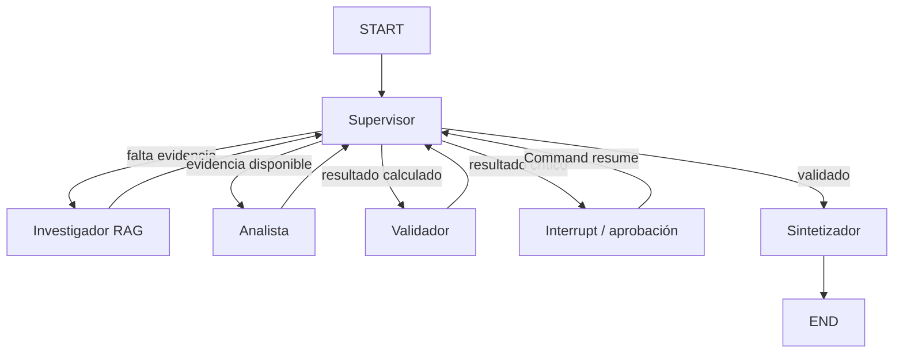

# Incident Intelligence System

Sistema de IA para investigar incidentes técnicos, recuperar evidencia documental, calcular su
prioridad y producir una respuesta trazable. La solución combina RAG híbrido, un grafo jerárquico
de agentes, persistencia en Redis, aprobación humana y una API asíncrona instrumentada con Phoenix.

## Capacidades

- Recuperación híbrida: embeddings densos y BM25 sobre el mismo corpus.
- Índice local persistente para ejecución reproducible y backend Pinecone opcional.
- Supervisor LangGraph con investigadores, analista, validador y sintetizador.
- Cálculo determinista de prioridad P1–P4 a partir de métricas recuperadas.
- Interrupción y aprobación humana para resultados críticos.
- Trabajos en background con backpressure y estados persistidos en Redis.
- Checkpoints de LangGraph asociados al `job_id` para pausa y reanudación.
- Contratos Pydantic estrictos para API, RAG, herramientas y resultados.
- OpenTelemetry, OpenInference y Arize Phoenix para trazas, tokens, costo y latencia.
- Modelos de chat intercambiables entre OpenAI y Anthropic.

## Arquitectura



### Grafo de agentes



Las guardas del Supervisor impiden sintetizar sin evidencia, cálculo y validación. El límite de
decisiones y el `recursion_limit` evitan ciclos ilimitados.

## Flujo RAG

1. Los documentos de `data/knowledge/` se validan con Pydantic.
2. El contenido se fragmenta con solapamiento y conserva fuente, página, categoría, etiquetas y
   métricas.
3. El backend local reutiliza embeddings guardados en `state/rag-index.json` mientras no cambie el
   corpus. Pinecone puede reemplazarlo mediante `RAG_BACKEND=pinecone`.
4. Cada consulta combina similitud coseno y BM25 con pesos configurables.
5. Se deduplican documentos y se entregan hasta cinco fuentes al investigador.
6. El resultado final expone las referencias utilizadas.

El Golden Set de cinco preguntas está en `evaluation/golden_set.json`. El resultado reproducido se
encuentra en [`artifacts/rag-evaluation.json`](artifacts/rag-evaluation.json):

| Métrica | Resultado |
| --- | ---: |
| Consultas | 5 |
| Precision@5 media | 0.36 |
| Recall@5 medio | 0.90 |

## Inicio con Docker Compose

Requiere Docker Desktop y una clave válida de OpenAI. La clave de OpenAI también genera los
embeddings cuando el chat usa Anthropic.

```bash
copy .env.example .env
```

Completar las credenciales necesarias y levantar todos los servicios:

```bash
docker compose up --build
```

| Servicio | URL |
| --- | --- |
| API | <http://localhost:8000> |
| Swagger UI | <http://localhost:8000/docs> |
| OpenAPI | <http://localhost:8000/openapi.json> |
| Phoenix | <http://localhost:6006> |
| Redis | `localhost:6379` |

La ruta de salud confirma Redis y el corpus RAG cargado:

```bash
curl http://localhost:8000/health
```

Respuesta esperada:

```json
{
  "status": "ok",
  "redis": "ok",
  "queue_depth": 0,
  "rag_backend": "local",
  "rag_documents": 8,
  "rag_chunks": 8
}
```

## API

### Crear un trabajo

```bash
curl -X POST http://localhost:8000/jobs \
  -H "Content-Type: application/json" \
  -d '{"request":"Investiga los errores de checkout y calcula su prioridad con evidencia."}'
```

La API responde `202 Accepted` con un `job_id` y no bloquea mientras se ejecutan el RAG y los
agentes.

### Consultar el estado

```bash
curl http://localhost:8000/jobs/JOB_ID
```

Estados posibles: `QUEUED`, `RUNNING`, `WAITING_APPROVAL`, `COMPLETED`, `REJECTED` y `FAILED`.

### Aprobar o rechazar

Cuando el estado sea `WAITING_APPROVAL`:

```bash
curl -X POST http://localhost:8000/jobs/JOB_ID/approval \
  -H "Content-Type: application/json" \
  -d '{"approved":true,"feedback":"Riesgo revisado por operaciones."}'
```

El mismo endpoint acepta `approved: false`. La reanudación usa el mismo `thread_id` y continúa desde
el checkpoint interrumpido.

## Proveedores y backends

### Chat con OpenAI

```text
LLM_PROVIDER=openai
OPENAI_API_KEY=...
OPENAI_MODEL=gpt-5.4-mini
```

### Chat con Anthropic

```text
LLM_PROVIDER=anthropic
ANTHROPIC_API_KEY=...
ANTHROPIC_MODEL=claude-sonnet-4-5
OPENAI_API_KEY=...
```

### Pinecone

```text
RAG_BACKEND=pinecone
PINECONE_API_KEY=...
PINECONE_INDEX_NAME=incident-intelligence
PINECONE_NAMESPACE=technical-knowledge
```

El índice se crea con la dimensión configurada y métrica coseno. Las llamadas síncronas del SDK se
ejecutan con `asyncio.to_thread` para no bloquear el event loop.

## Persistencia y tolerancia a fallos

- `RedisJobRepository` conserva estado, resultado y error durante 24 horas.
- `AsyncRedisSaver` guarda los checkpoints internos de LangGraph.
- La cola acotada devuelve `503` al alcanzar su capacidad.
- El worker captura excepciones y publica `FAILED` con el tipo y mensaje.
- Una salida estructurada inválida del modelo utiliza una degradación determinista y validada.
- El índice local se invalida automáticamente cuando cambia el corpus.

## Observabilidad

El proyecto `incident-intelligence-system` recibe spans de FastAPI, LangGraph, modelos, herramientas
y trabajos. El span `agent_job.execute` incorpora `job.id`, número de worker y condición de
reanudación. `rag.retrieve` registra consulta, cantidad de resultados e identificadores documentales.

Evidencias:

- [Trazas de trabajos](screenshots/final-phoenix-traces.png)
- [Detalle del Supervisor, RAG y especialistas](screenshots/final-phoenix-trace-detail.png)
- [Costo y latencia](screenshots/final-phoenix-cost-latency.png)
- [Dashboard de tokens y percentiles](screenshots/final-phoenix-dashboards.png)

## Pruebas del sistema

La prueba concurrente ejecuta cinco consultas distintas, reanuda automáticamente los casos que
requieren aprobación y guarda las referencias de cada resultado:

```bash
python scripts/load_test.py --base-url http://localhost:8000
```

Resultado guardado en
[`artifacts/final-system-tests.json`](artifacts/final-system-tests.json):

| Métrica | Resultado |
| --- | ---: |
| Concurrencia | 5 |
| Trabajos completados | 5/5 |
| Aprobaciones HITL | 2/5 |
| Latencia p95 extremo a extremo | 71.618 s |

Escenarios: checkout, atraso del índice de búsqueda, memoria de Redis, saturación del adaptador de
pagos y política de aprobación humana.

## Calidad

```bash
pytest
ruff check .
docker compose config --quiet
```

Las pruebas cubren recuperación híbrida, evaluación, contratos Pydantic, herramientas, guardas del
Supervisor, cálculo de prioridad, pausa y reanudación, Redis, backpressure y endpoints.

## Estructura

```text
.
|-- data/knowledge/                 corpus técnico
|-- evaluation/golden_set.json     casos relevantes del RAG
|-- artifacts/                     resultados reproducibles
|-- screenshots/                   evidencias de Phoenix
|-- scripts/                        evaluación, carga y captura
|-- src/multi_agent_orchestrator/
|   |-- agents/                    especialistas
|   |-- api/                       FastAPI, Redis y workers
|   |-- rag/                       documentos, backends y fusión híbrida
|   |-- graph.py                   grafo jerárquico
|   |-- supervisor.py              enrutamiento y guardas
|   |-- approval.py                human-in-the-loop
|   `-- observability.py           Phoenix y OpenTelemetry
|-- tests/
|-- compose.yaml
|-- Dockerfile
`-- pyproject.toml
```

Las claves reales, checkpoints, índices locales y archivos `.env` están excluidos del repositorio.
